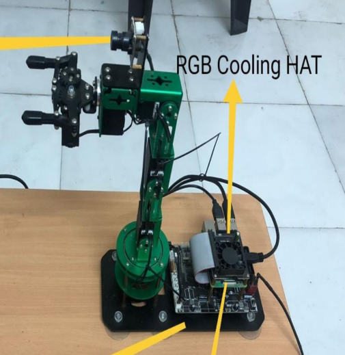

# Computer Vision-Based 6-DOF Robotic Arm for Real-Time Fruit Sorting

[](https://wiki.ros.org/)
[](https://www.python.org/)
[](https://moveit.ros.org/)
[](https://opencv.org/)
[](https://www.yahboom.net/)
[](LICENSE)

An autonomous robotic manipulation system designed for post-harvest agricultural sorting. This project combines **deep learning object detection (YOLOv4)**, **real-time computer vision (OpenCV)**, **analytical and MoveIt kinematics**, and an **embedded 6-DOF robotic manipulator** powered by a Raspberry Pi 4B to automatically classify, pick, and sort fruits (e.g., apples vs. oranges) into designated collection bins.

---

## 📸 Hardware Setup

<p align="center">
  
  <br>
  <em>Figure 1: 6-DOF Robotic Manipulator with Raspberry Pi 4B, Yahboom RGB Cooling HAT, Camera, and Driver Expansion Board.</em>
</p>

### 🛠️ Hardware Bill of Materials (BOM)
* **Manipulator:** Yahboom DOFBOT 6-DOF robotic arm (5 high-precision digital serial bus servos + 1 mechanical gripper).
* **Onboard SBC:** Raspberry Pi 4B (Quad-core Cortex-A72 @ 1.5GHz).
* **Thermal Management:** Yahboom RGB Cooling HAT (active PWM cooling fan + multi-effect status LEDs).
* **Vision Sensor:** High-definition USB wide-angle camera mounted on the arm structure.
* **Actuator Control:** Dedicated I2C multi-channel servo expansion board with external 12V power supply.

---

## 🎬 Project Demos & Documentation

* 🎥 **Video Demo 1:** [`media/fruit_sorting_demo.mp4`](media/fruit_sorting_demo.mp4) — Real-time fruit classification, grasping, and bin sorting.
* 🎥 **Video Demo 2:** [`media/manipulator_demo.mp4`](media/manipulator_demo.mp4) — 6-DOF arm trajectory planning and grasping action.
* 📄 **Capstone Report:** [`docs/final_project_report.pdf`](docs/final_project_report.pdf) — Comprehensive 120-page thesis submitted to College of Engineering Pune (COEP).
* 📊 **Presentation Slides:** [`docs/sem_project_presentation.pdf`](docs/sem_project_presentation.pdf) — Project architecture, torque calculations, and experimental results.

---

## 🧠 System Architecture

```
                 +-----------------------+
                 |  USB Camera / Stream  |
                 +-----------+-----------+
                             | (RGB Frame 640x480)
                             v
                 +-----------------------+
                 | YOLOv4 / HSV Detector |
                 | Class: Apple / Orange |
                 +-----------+-----------+
                             | (Bounding Box & Centroid u,v)
                             v
                 +-----------------------+
                 | Homography Coordinate |
                 |      Transformer      |
                 +-----------+-----------+
                             | (Cartesian Target x, y, z in mm)
                             v
                 +-----------------------+
                 | Kinematics / MoveIt   |
                 |  Trajectory Planner   |
                 +-----------+-----------+
                             | (Joint Angles θ1 - θ6)
                             v
                 +-----------------------+
                 | Yahboom I2C Arm Driver|
                 |  6-DOF Digital Servos |
                 +-----------------------+
```

---

## 📐 Kinematics & Mathematical Modeling

The manipulator's kinematic structure is modeled using standard **Denavit-Hartenberg (D-H)** parameters:

| Link $i$ | Joint Angle $\theta_i$ | Link Offset $d_i$ (mm) | Link Length $a_i$ (mm) | Twist Angle $\alpha_i$ |
| :---: | :---: | :---: | :---: | :---: |
| **1** | $\theta_1$ | $104.0$ | $0$ | $+90^\circ$ |
| **2** | $\theta_2$ | $0$ | $82.85$ | $0^\circ$ |
| **3** | $\theta_3$ | $0$ | $82.85$ | $0^\circ$ |
| **4** | $\theta_4$ | $0$ | $0$ | $+90^\circ$ |
| **5** | $\theta_5$ | $128.0$ | $0$ | $0^\circ$ |

### Inverse Kinematics (IK)
Given a target coordinate $(x, y, z)$ on the sorting platform:
1. **Base Azimuth ($\theta_1$):**
   $$\theta_1 = \text{atan2}(y, x)$$
2. **Wrist Position:**
   $$r_w = \sqrt{x^2 + y^2} - d_5 \cos(\phi), \quad z_w = z - d_1 - d_5 \sin(\phi)$$
3. **Elbow Angle ($\theta_3$) via Law of Cosines:**
   $$\cos(\theta_3) = \frac{r_w^2 + z_w^2 - a_2^2 - a_3^2}{2 a_2 a_3}$$
4. **Shoulder Angle ($\theta_2$):**
   $$\theta_2 = \text{atan2}(z_w, r_w) - \text{atan2}(a_3 \sin\theta_3, a_2 + a_3 \cos\theta_3)$$

---

## 💻 Repository Structure

```
├── config/
│   └── sorting_params.yaml         # Camera, workspace, and bin configurations
├── docs/
│   ├── final_project_report.pdf    # Full B.Tech Thesis (COEP)
│   └── sem_project_presentation.pdf# Defense presentation deck
├── launch/
│   └── fruit_sorting.launch        # ROS launch file
├── media/
│   ├── hardware_setup.png          # System hardware photo
│   ├── fruit_sorting_demo.mp4      # Demo video 1
│   └── manipulator_demo.mp4        # Demo video 2
├── models/
│   ├── classes.names               # Target object categories
│   └── yolov4-tiny-fruit.cfg       # Darknet architecture config
├── src/
│   ├── hardware/
│   │   ├── Arm_Lib.py              # I2C driver for 6 digital bus servos
│   │   └── cooling_hat.py          # Thermal regulation daemon for RGB Cooling HAT
│   ├── kinematics/
│   │   └── dofbot_kinematics.py    # Analytical Forward & Inverse Kinematics solver
│   ├── motion_planning/
│   │   └── moveit_controller.py    # MoveIt Commander ROS wrapper
│   ├── vision/
│   │   ├── coordinate_transformer.py # Camera homography perspective mapping
│   │   ├── fruit_detector_hsv.py   # Color-space segmentation fallback
│   │   └── fruit_detector_yolo.py  # YOLOv4 deep learning inference engine
│   └── main_sorting_node.py        # Central execution and state machine
├── requirements.txt                # Python dependencies
├── LICENSE                         # MIT License
└── README.md
```

---

## 🚀 Getting Started

### 1. Prerequisites
* **Operating System:** Ubuntu 18.04 / 20.04 with ROS Melodic or Noetic (or Raspberry Pi OS with ROS).
* **Python:** 3.7+

### 2. Installation
```bash
# Clone the repository
git clone https://github.com/ankushx/robotic-arm-fruit-sorting.git
cd robotic-arm-fruit-sorting

# Install dependencies
pip3 install -r requirements.txt
```

### 3. Running the Sorting System
```bash
# Direct standalone execution (with camera and robot connected)
python3 src/main_sorting_node.py

# Or via ROS launch:
roslaunch launch/fruit_sorting.launch
```

---

## 👥 Authors & Academic Attribution

This project was developed as a Bachelor of Technology Capstone Project at the **College of Engineering Pune (COEP)**, Department of Mechanical Engineering (2021–2022).

* **Ankush Ukey** ([@ankushx](https://github.com/ankushx))
* **Mayuresh Kshirsagar**
* **Anshul Chandekar**
* **Tejas Ukey**
* **Project Guide:** Prof. Dr. S. S. Ohol, Department of Mechanical Engineering, COEP.
